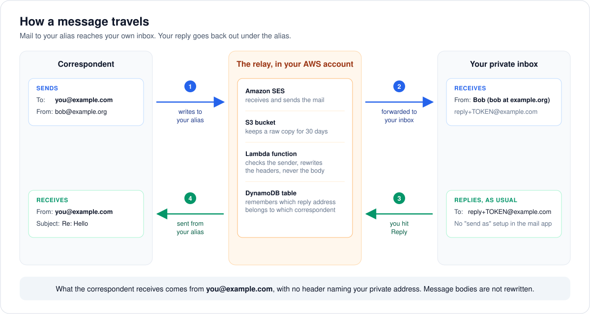
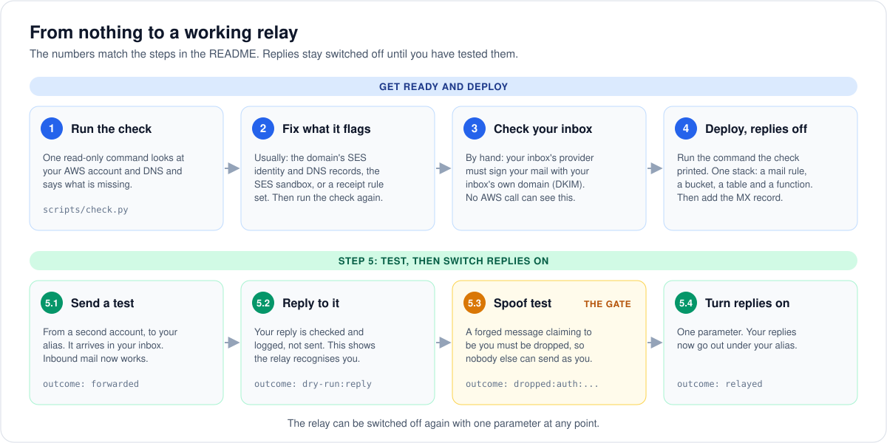

# serverless-mail

Give out an address on your own domain, read the mail in the inbox you already use, and reply from there. The other person sees only the address on your domain.

Runs in your AWS account on SES, Lambda, S3 and DynamoDB. Cents a month at personal volume. No "send mail as" setup in your mail app.



Bob writes to `you@example.com`. You see `From: "Bob (bob at example.org)" <reply+TOKEN@example.com>`. You hit Reply. Bob sees `From: you@example.com`.

## Status

Deployed once, by its author, for one alias, in `us-east-1`, with Google Workspace as the inbox. Not tried in another region or in the SES sandbox. The reply check depends on the form of a header SES adds, seen in `us-east-1` only. The spoof test below has not been run. `PLAN.md` is the full design and lists what is unverified.

## Requirements

- AWS CLI v2 with rights to create CloudFormation stacks, IAM roles, Lambda, S3, DynamoDB, log groups and SES receipt rules. Python 3.9 or later.
- A region where [SES receives mail](https://docs.aws.amazon.com/general/latest/gr/ses.html).
- A domain or subdomain whose MX can point at SES. All mail for that name goes to SES, so use a subdomain such as `r.example.com` if the domain already receives mail.
- An inbox whose provider signs with the inbox's own domain (DKIM), and a DMARC record on that domain. Without both, every reply is refused.

One stack serves one alias on one domain, per account and region.

## Setup



**1. Run the check.** Read-only. It prints `ok`, `fix` or `note` lines, then your deploy command.

```sh
python3 scripts/check.py --region us-east-1 --domain example.com \
  --alias you@example.com --inbox private@example.net
```

**2. Fix what it flags.** Each `fix` line carries its command. The usual ones:

- No SES identity: create it, publish the DKIM records SES returns, and add `_dmarc.example.com TXT "v=DMARC1; p=none"`.
- SES sandbox: forwards need your inbox as a verified identity; replies need production access, requested in the SES console.
- No active receipt rule set: create and activate one. Never activate a set while another is active; that switches the live one off. The stack only adds one rule, `relay-inbound`, to the set you name.

**3. Check your inbox.** The check cannot see this. Send a message from your inbox to another provider and read its `DKIM-Signature`: `d=` must be your inbox's domain, with no second signature for another domain, and `h=` must list `to` twice and `cc`. In Google Workspace, switch on your own DKIM key under Apps, Gmail, Authenticate email.

**4. Deploy with replies off.** Run the commands the check printed, then add the MX record.

```sh
python3 scripts/render.py
aws cloudformation deploy --region us-east-1 --stack-name mailrelay \
  --template-file build/relay.yml --capabilities CAPABILITY_IAM \
  --parameter-overrides Domain=example.com Alias=you@example.com \
    PrivateAddress=private@example.net RuleSetName=relay AfterRule= \
    OutboundEnabled=false
```

```
example.com  MX  10 inbound-smtp.us-east-1.amazonaws.com
```

A failed first deploy leaves an empty stack; delete it before retrying.

**5. Test, then switch replies on.** Watch `aws logs tail /aws/lambda/mailrelay --follow`.

1. Mail the alias from another account: `forwarded`.
2. Reply to it: `dry-run:reply`. Nothing is sent.
3. Spoof test: from a server with its own DKIM, send to your `reply+TOKEN` address with `From:` set to your private address. It must log `dropped:auth:`.
4. Deploy again with `OutboundEnabled=true`. A reply now logs `relayed`.

## Parameters

| Parameter | Default | Purpose |
|---|---|---|
| `Domain` | | Relay domain, lowercase |
| `Alias` | | The address correspondents write to, lowercase |
| `PrivateAddress` | | Your inbox, written as your provider puts it in From |
| `RuleSetName` | `default-rule-set` | The active receipt rule set to join |
| `AfterRule` | empty | Rule to follow in that set. Empty means first |
| `AliasDisplayName` | empty | Name shown on your replies |
| `OutboundEnabled` | `false` | `false` checks and logs replies without sending |
| `RuleEnabled` | `true` | Turns the receipt rule on or off |
| `MaxBytes` | 39845888 | Largest message relayed |
| `RetentionDays` | 30 | How long raw copies stay in the bucket |

A stack deployed before `RuleSetName` and `AfterRule` existed must pass `AfterRule=<the rule it follows>` on its next update.

## Using it

- Reply to a forward as you would to any mail.
- Start a conversation by writing to `you+bob=example.org@example.com` to reach `bob@example.org`.
- Only reply addresses and that compose form go through the relay. Any other address in To or Cc gets the mail from your private address.
- Headers are rewritten, bodies are not. A private address in your signature goes out as written.

## Troubleshooting

`aws logs tail /aws/lambda/mailrelay --since 1h` shows one JSON line per recipient with an `outcome`. No addresses, subjects or bodies are logged.

- Nothing logged: the message never reached the function. Check the MX, the active rule set, `RuleEnabled`, and the exact address.
- A traceback: the function raised and Lambda retries twice. The raw copy stays in the bucket.
- `send rejected: CODE`: SES refused a message. `notice not sent: CODE`: the notice to you failed and the event is retried. `anchor not stored: CODE`: a reply was sent but may not thread next time.

`notice:` outcomes also mail you the reason. `quarantined` and `dropped:` outcomes mail nobody.

| Outcome | Meaning |
|---|---|
| `forwarded` | Sent to your inbox. Look in spam if missing |
| `relayed` | Your reply was sent from the alias |
| `composed` | Your new message was sent from the alias |
| `duplicate` | Same event twice; the first was handled |
| `dry-run:reply` | Reply passed every check; replies are off |
| `dry-run:compose` | New message passed every check; replies are off |
| `quarantined` | Virus scan not passed, definite spam, or DMARC failure under reject or quarantine |
| `dropped:own-output` | Loop guard: the relay's own marker |
| `dropped:own-address` | Sender was your private address or a relay address |
| `dropped:unknown-recipient` | Neither the alias nor a reply address |
| `dropped:no-relay-recipient` | No recipient on the relay domain |
| `dropped:auth:scan` | Mail to a reply address failed the virus or spam scan |
| `dropped:auth:verdict` | No passing DKIM signature, or DMARC failed |
| `dropped:auth:dkim-alignment` | Not proven signed by your inbox's domain. Redo step 3 and check DMARC |
| `dropped:auth:duplicate-header` | More than one From, Sender, To or Cc |
| `dropped:auth:from` | From was not exactly `PrivateAddress` |
| `dropped:auth:sender` | A Sender header named someone else |
| `dropped:auth:envelope-sender` | Envelope sender empty or malformed |
| `dropped:auth:recipient-not-in-header` | Reply address was not in To or Cc |
| `notice:oversize` | Larger than `MaxBytes` |
| `notice:oversize-headers` | Headers over 256 KB |
| `notice:malformed-headers` | Bare carriage return or control character in headers |
| `notice:rejected` | SES permanently refused the send |
| `notice:no-sender` | No usable sender address |
| `notice:no-reply-to` | Mail From the alias itself with no single Reply-To |
| `notice:unknown-token` | Reply address the relay does not know |
| `notice:bad-compose-target` | Compose address without a valid `local=domain` |
| `notice:own-address` | Addressed to yourself or the relay |
| `notice:header-guard` | Subject or attachment name holds your private address |
| `notice:header-too-large` | Subject and content headers over 16 KB |
| `notice:no-message-id` | Reply has no usable Message-ID |
| `notice:auto-submitted` | Automatic reply; never relayed |
| `notice:precedence` | Marked bulk or automatic |
| `notice:list` | Mailing list header |
| `notice:report` | Delivery report |

## Operations

**Switch it off.** `OutboundEnabled=false` stops replies. `RuleEnabled=false` stops the relay.

**Replay a message.** Raw copies stay under `raw/` in the bucket for `RetentionDays`. Invoke the function with an SES event naming the stored object:

```json
{"Records": [{"eventSource": "aws:ses", "ses": {
  "mail": {"messageId": "STORED_OBJECT_NAME", "source": "sender@example.org", "commonHeaders": {}},
  "receipt": {"recipients": ["you@example.com"],
    "spamVerdict": {"status": "PASS"}, "virusVerdict": {"status": "PASS"},
    "spfVerdict": {"status": "PASS"}, "dkimVerdict": {"status": "PASS"},
    "dmarcVerdict": {"status": "PASS"}}}}]}
```

A message already sent is skipped until its marker is deleted from the table: `d#STORED_OBJECT_NAME#you@example.com` for a forward, `d#<Message-ID without angle brackets>#<reply address>` for a reply.

**Removing it.** Deleting the stack keeps the bucket and the table on purpose: they hold stored mail and your reply addresses. Their names are fixed, so a new stack cannot be created until they are deleted, which breaks replies to old forwards.

```sh
aws cloudformation delete-stack --stack-name mailrelay --region us-east-1
aws s3 rb s3://mailrelay-ACCOUNT_ID-us-east-1 --force
aws dynamodb delete-table --table-name mailrelay --region us-east-1
```

The MX record, the SES identity and the rule set are yours to remove.

## Limits

- One alias, one domain, one stack per account and region.
- 38 MiB per message is configured, not tested.
- A reply goes to one correspondent. No group conversations.
- Cost is estimated at $0.29 to $0.41 a month for 1,000 inbound messages and 300 replies (`PLAN.md` section 15).

## Development

```sh
python3 -m unittest discover -s tests
```

Standard library only, with fake AWS clients. The runtime is Python 3.12; the suite also passes on 3.9 and 3.14.

MIT. See `LICENSE`.
